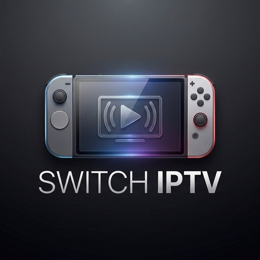
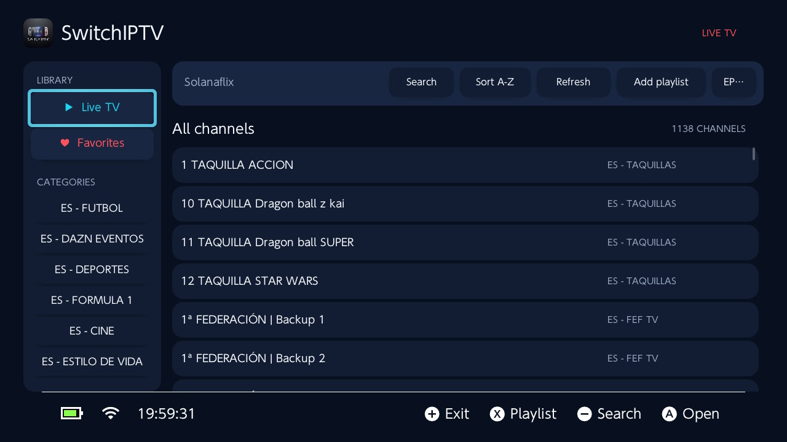
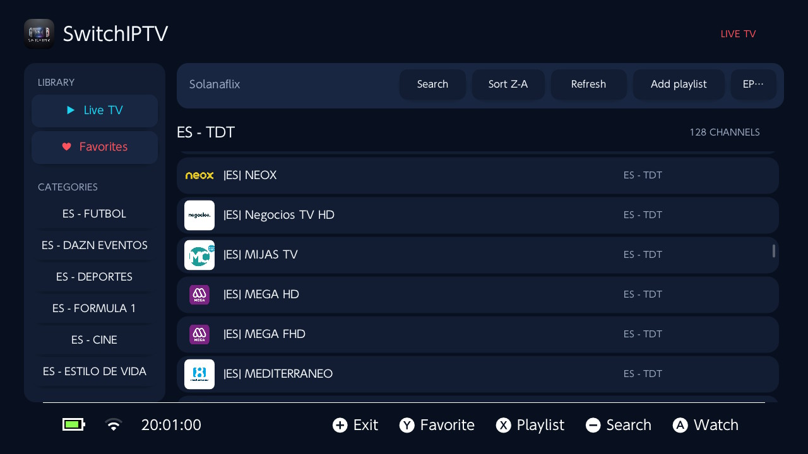

<p align="center">
  
</p>

<h1 align="center">SwitchIPTV</h1>

<p align="center">
  A controller-first IPTV player for Nintendo Switch with a clean, TV-friendly interface.
</p>

SwitchIPTV makes it easy to browse and watch channels from your own M3U or M3U8 playlist in handheld mode or on a docked TV.

> SwitchIPTV does not provide channels, playlists, subscriptions, or copyrighted content. Use only streams that you are authorized to access.

## What's new in 0.2.0

- Added channel search and A-Z/Z-A sorting.
- Added XMLTV and compressed XMLTV.GZ programme-guide support.
- Added category switching, favorites, responsive layouts, and improved playback controls.
- Added audio-track and subtitle selection.
- Added host-side parser and storage tests for safer releases.

## Screenshots

<p align="center">
  
  
</p>

## Features

- Remote and local M3U/M3U8 playlists
- Channel categories and favorites
- Channel search
- Alphabetical sorting in A-Z or Z-A order
- Channel logos from playlist metadata
- XMLTV programme guide support, including compressed `.xml.gz` guides
- Current and next programme information
- Full-screen video playback with stereo audio
- Fast channel switching without leaving the player
- Multiple audio-track and subtitle selection
- Auto, 16:9, 4:3, and Fill aspect modes
- Nintendo Switch software keyboard support
- Controller and touch-screen navigation
- Responsive handheld and docked-TV layouts
- Persistent playlist, EPG, and favorite settings

## Installation

1. Download `SwitchIPTV.nro` from the latest release.
2. Create `/switch/SwitchIPTV/` on the SD card.
3. Copy `SwitchIPTV.nro` into that directory.
4. Start SwitchIPTV from the Homebrew Menu.
5. Select **Add playlist** or press **X**, then enter your M3U/M3U8 URL or a local `sdmc:/` path.

The final layout should be:

```text
/switch/SwitchIPTV/SwitchIPTV.nro
```

## Playlist and EPG setup

Playlists can be added directly inside the application. Both HTTP(S) URLs and local files are supported:

```text
https://provider.example/channels.m3u
sdmc:/playlists/channels.m3u
```

To use an external programme guide, select **EPG** and enter an XMLTV or XMLTV.GZ URL. SwitchIPTV also detects the guide URL from supported M3U playlist metadata.

Advanced users may create `/switch/SwitchIPTV/config/settings.ini`:

```ini
playlist_source=https://provider.example/channels.m3u
playlist_name=My IPTV
epg_source=https://provider.example/guide.xml.gz
hidden_groups=Adult,Radio
```

Do not publish playlist URLs or configuration files containing account credentials.

## Controls

### Channel browser

| Control | Action |
| --- | --- |
| D-pad / Left Stick | Navigate the interface |
| A | Select or play a channel |
| B | Go back |
| X | Add or change the playlist |
| Y | Add or remove a favorite |
| Minus | Search channels |
| + | Refresh the playlist |
| L / R | Change category |

### Player

| Control | Action |
| --- | --- |
| A | Pause or resume |
| B | Return to the channel browser |
| D-pad Up / Down | Previous or next channel |
| L / R | Previous or next channel |
| X | Change audio track |
| Y | Change subtitle track |
| D-pad Right | Change aspect ratio |
| + | Show playback controls |

Playback controls disappear automatically after three seconds.

## Building from source

### Requirements

- devkitPro with devkitA64 and libnx
- Switch portlibs for SDL2, FFmpeg, curl, mbedTLS, zlib, bzip2, FreeType, HarfBuzz, and libpng
- CMake and a Make-compatible build tool
- Git submodules

Initialize dependencies:

```sh
git submodule update --init --recursive
```

Configure and build the Borealis frontend:

```sh
cmake -G "Unix Makefiles" -B cmake-build-switch \
  -DPLATFORM_SWITCH=ON \
  -DUSE_SDL2=ON \
  -DBRLS_UNITY_BUILD=OFF \
  -DCMAKE_DEPENDS_USE_COMPILER=OFF
cmake --build cmake-build-switch --target SwitchIPTV.nro -j 2
```

The resulting file is `cmake-build-switch/SwitchIPTV.nro`.

## Privacy

SwitchIPTV stores its settings and favorites locally on the SD card. Playlist, guide, logo, and stream requests are sent directly to the URLs configured by the user.

## Credits

SwitchIPTV is built with [Borealis](https://github.com/xfangfang/borealis), SDL2, FFmpeg, and libnx.
